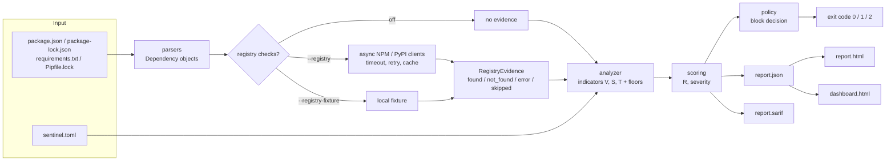

# Architecture

## Data flow

JSON is the single source of truth: HTML is rendered from the same dictionary and SARIF from the same
findings, which is why counts, scores and severities agree (tested in `tests/test_reports.py`).

## Modules

| Module | Responsibility |
|---|---|
| `models.py` | Frozen dataclasses: `Dependency`, `RegistryEvidence`, `Finding`, `Indicator`, `PolicyDecision` |
| `parsers/` | Read manifests/lockfiles into `Dependency` objects; warnings for lines that cannot be understood, errors for unreadable files |
| `analysis/names.py` | PEP 503 / NPM name normalization |
| `analysis/similarity.py` | Hand-written Levenshtein and Damerau (OSA) distance; false-positive filters |
| `analysis/versions.py` | Semver (NPM) and PEP 440 (PyPI) comparison |
| `registry/http.py` | `Fetcher`: timeout, concurrency limit, retry with backoff, `Retry-After`, size cap, no redirects |
| `registry/npm.py`, `pypi.py` | URL building, name validation, response parsing |
| `registry/common.py` | One place mapping HTTP outcomes to found / not_found / error |
| `registry/cache.py` | Bounded LRU cache (definitive answers only) |
| `registry/fixture.py` | Registry answers from a local file for demos and tests |
| `config.py` | `sentinel.toml` loading, validation, internal-name matching |
| `analyzer.py` | Turns dependencies + evidence + config into `Finding`s |
| `scoring.py` | `R = min(100, Wv*V + Ws*S + Wt*T)`, floors, severity bands |
| `policy.py` | Decides blocking from severities; exit codes |
| `reporting/` | JSON, HTML (Jinja2, autoescaped), SARIF 2.1.0 and a structural SARIF validator |
| `dashboard/index.html` | Static dashboard; untrusted data is inserted only as text |

## Security decisions in the code

- **Nothing scanned is installed or executed.** Only files are read and registry metadata is fetched.
- **Names are untrusted input.** They are validated with `re.fullmatch` before being placed in a URL
  (`../x`, `pkg?x=1`, trailing newlines are rejected and reported as skipped, never requested).
- **Redirects are not followed**, response size is capped (20 MB), requests have a total timeout.
- **Failures are never silently SAFE.** A failed lookup is `error` (exit 2); an unqueried name is
  `skipped`/`partial`; a 404 is `not_found` and is *not* treated as proof of safety.
- **Secrets are redacted at parse time** (`user:pass@`, tokens, query strings in URLs), so reports cannot leak them.
- **Reports escape data**: Jinja2 autoescape in HTML; the dashboard uses `textContent`/text nodes only.
- **`-r other.txt` is not followed**, so a requirements file cannot make the scanner read arbitrary paths.
- **Unknown config keys are errors.**

## What is sent to public services

With `--registry`, for every registry-sourced package name found in the scanned files, one HTTPS GET to
`registry.npmjs.org/<name>` or `pypi.org/pypi/<name>/json`, with a `User-Agent` of
`devsecops-sentinel/<version>`. Nothing else is sent: no file contents, no credentials, no repository name.
Git, URL and local dependencies are never queried. With `[privacy] query_internal_names = false`,
names matching your `[internal]` rules are not sent at all (their checks are reported as incomplete).
Without `--registry` nothing leaves the machine. Reports contain the names of your internal packages if
you declare them, so treat report artifacts accordingly.

## Exit-code contract

`0` pass, `1` policy block, `2` scanner error. The GitHub Action uploads reports in every case and
applies the verdict in its final step, so a blocked or failed scan still leaves evidence behind.
